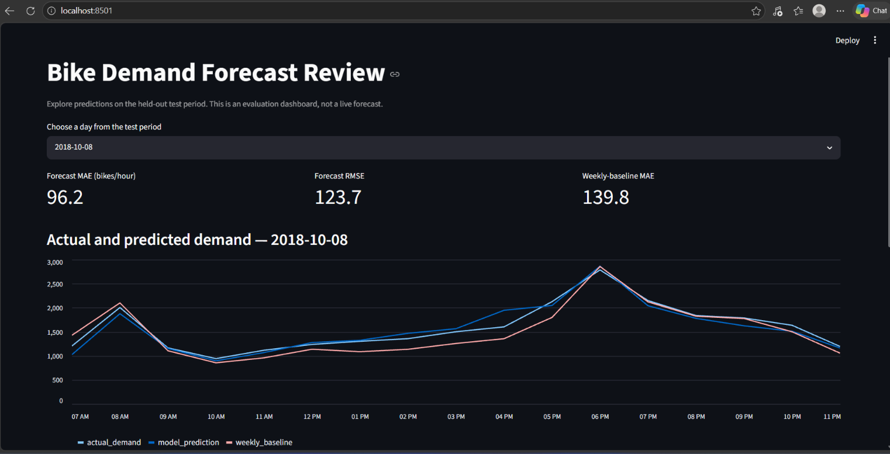
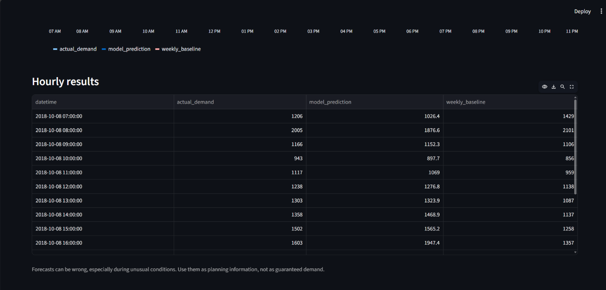

# Seoul Bike Demand Forecasting and Planning

## Project question
Can the next hour's citywide bike rental demand be estimated from earlier demand, calendar information, and weather observed by the previous hour?

This project builds and evaluates an hourly demand forecast for the Seoul Bike Sharing dataset. The aim is to help an operations team anticipate busy periods. The dataset contains citywide hourly counts, not individual station inventory, so this project does not make station-level rebalancing recommendations.

## Latest run
The guided notebook was run on the UCI dataset. On the chronological test period, the random forest achieved an MAE of 69.4 bikes per hour and an RMSE of 109.0. The same-hour-last-week baseline had an MAE of 340.0 and an RMSE of 548.8. The model's test MAE was 79.6% lower than the baseline's for this test period.

These are benchmark results for this dataset and split, not a guarantee of performance for another operator. Re-run the notebook if the data or code changes, and update these values to match that run before publishing.

## Project status
The notebook contains the full analysis workflow and generates the CSV used by the dashboard. Run it from the repository root before starting the dashboard.

## Files
- notebooks/bike_demand_forecasting.ipynb: guided analysis, data checks, feature creation, chronological evaluation, error analysis, and prediction export.
- app.py: a Streamlit dashboard for exploring predictions on the held-out test period. Run the notebook first to create its input file.
- requirements.txt: packages needed for the notebook and dashboard.
- reports/: generated predictions are written here; the dataset itself is fetched from UCI and is not bundled.

## Dashboard screenshots

The dashboard compares actual hourly demand with the model forecast and a same-hour-last-week baseline for a selected test day.

**Daily overview**

**Hourly results**

## Method
The prediction target is bike rentals for an hour. Inputs include calendar details known in advance, rental counts from 1 hour, 24 hours, and 1 week earlier, and weather measurements from the previous hour. This avoids using the target hour's observed weather as if it were already known.

The first 70% of time-ordered records are used for training, the next 15% for validation, and the final 15% for testing. The model is compared with a seasonal-naive baseline that predicts the same hour's count from the previous week. A chronological split is appropriate because a forecasting model should be assessed on later periods, not on randomly mixed past and future records.

Metrics:
- MAE: average absolute forecast error, measured in bikes per hour.
- RMSE: forecast error that penalizes larger misses more strongly.

The notebook reports the relative MAE improvement or deterioration against the baseline. The baseline is important: it shows whether the more complex model adds value over a simple forecast.

## Run it
Use Python 3.10 or newer. From the repository root:

~~~bash
python -m pip install -r requirements.txt
jupyter notebook
~~~

Open and run all cells in notebooks/bike_demand_forecasting.ipynb. This fetches the public dataset, runs the analysis, and writes reports/test_predictions.csv.

Then start the dashboard from the repository root:

~~~bash
streamlit run app.py
~~~

The dashboard displays test-period predictions and errors. It is an evaluation viewer, not a live forecasting service.

## Data source and attribution
The data comes from the UCI Seoul Bike Sharing Demand dataset: https://archive.ics.uci.edu/dataset/560/seoul%2Bbike%2Bsharing%2Bdemand. The notebook retrieves data through the ucimlrepo package and does not include a separate copy. Review UCI's current dataset terms before redistributing data separately.

## Limitations
- The data represents one city's historical records, not every bike-sharing system.
- It is a benchmark dataset, not a live connection to a bike operator.
- Previous-hour weather is used as a proxy available at forecast time; a deployed service should use weather forecasts.
- Overall demand cannot identify which station needs bikes.
- Forecast errors may vary by hour and conditions; inspect the error-analysis plots before using results for planning.
- A forecast estimates demand. It does not prove that a particular operational action will improve outcomes.

## Reproducibility
The notebook fixes the model random seed and uses a chronological split. Package dependencies are listed in requirements.txt. Prediction output is generated locally and can be regenerated by rerunning the notebook.
